# Daily Content Automation (n8n)

A workflow that reads the public learning center of a medical tourism blog once a day, picks one article it has not used before, drafts a Facebook post with an LLM, checks the draft against hard rules and a second audit pass, and then publishes it to a Mastodon test account (or a Facebook test Page), or sends it to a reviewer first, or just records it in simulation mode. Every run is logged.

Platform: n8n. This is a prototype.

## Quick facts

| Item | Value |
| --- | --- |
| Workflow | `workflow-export.json` (41 nodes, import into n8n) |
| Trigger | Schedule, daily 09:00 in the n8n instance time zone, plus a manual trigger |
| Source | The public learning center of a medical tourism blog (set in `Demo Settings.sourceIndex`; public pages only) |
| Store | n8n data table `content_automation_runs` (created automatically) |
| Default mode | `auto` + `simulate` (nothing is posted until you switch it on) |
| Publish targets | Mastodon test account (live), Facebook Page (implemented, see limits) |
| Alerts and review drafts | Telegram |
| Samples | `SAMPLE-OUTPUT.md` (real generated posts with source URLs) |

## Architecture

```mermaid
flowchart LR
  T[Daily 09:00 / Manual] --> S[Demo Settings]
  S --> L[Read run ledger]
  L --> R[Fetch + check robots.txt]
  R --> I[Fetch learning-center index]
  I --> A[Select unused article]
  A -->|none| N[Record: skipped]
  A --> D[Wait: crawl delay]
  D --> F[Fetch article + extract metadata]
  F --> P[Build prompt]
  P --> G[LLM: draft]
  G --> V[Rule checks + evidence quotes]
  V --> U[LLM: audit claims]
  U --> C[Create result: simulated / awaiting_review / ready_to_publish / blocked]
  C -->|ready_to_publish| PT{Platform}
  PT -->|mastodon| M[Upload image + post status]
  PT -->|facebook| B[Facebook Graph API: test Page]
  M --> W[Write ledger]
  B --> W
  C --> W
  W --> X{Review or failure?}
  X -->|yes| TG[Telegram message]
  TG --> E[Stop and Error on failure]
```

Any node that fails routes its error output to a single failure record, which is written to the ledger, sent as a Telegram alert, and ends the execution as failed. Nothing fails silently.

## How each requirement is met

1. **Trigger.** A schedule trigger (daily 09:00) and a manual trigger, both starting at `Demo Settings`.
2. **Extract.** Method: HTML parsing. The learning-center index lists article links (`/learning-center/<slug>`). The article page exposes `og:title`, `meta description`, `og:image` and the `h1`, which give title, summary, URL and featured image. Why this method: the index and article pages are server rendered and expose all four fields directly, so plain HTTP plus CSS selectors is enough. A sitemap lists URLs but not summaries or images, so it would still need the same article requests, and a headless browser adds weight with no benefit. Cost per run: one robots.txt request, one index request and one article request.
3. **Select.** The first article on the index whose URL is not in the ledger with a finished status (`simulated`, `awaiting_review`, `blocked`, `published`). A URL that was blocked by the guardrails is not retried, so one bad article cannot loop. If nothing is new, the run is recorded as `skipped`.
4. **Generate.** An LLM drafts JSON: hook, 2 to 4 short lines, call to action, 3 to 5 hashtags and 1 to 3 verbatim evidence quotes. The final post is `hook + lines + CTA`, then the link, then the hashtags.
   - **Rule-based guardrails (code node):** hook, CTA and lines must be single clean lines with no URL or hashtag; counts must be within range; hashtags must be unique and well formed; text before the link must be under 500 characters; no currency symbols or currency codes, and no words such as cure, guarantee, risk-free, success rate or miracle; every evidence quote must appear word for word in the article title or summary.
   - **Second LLM pass:** an audit prompt receives the source and the finished post and must return `safe: true` with a reason. It marks the post unsafe if any line adds facts beyond the source, mentions price, suggests efficacy, gives medical advice, makes promises or is ambiguous. The audit does not rewrite the draft, so the post is never silently altered.
   - A post that fails either check is stored as `blocked` and never published.
5. **Publish.** With `publishMode = mastodon` the workflow downloads the featured image, uploads it to the Mastodon test account with a text description (alt text), and posts the status with the image attached. An `Idempotency-Key` built from the execution ID prevents a retry from posting twice. The text length is checked against Mastodon's 500 character limit, where a link counts as 23 characters. The returned post ID and URL are stored in the ledger. With `publishMode = facebook`, `Build Facebook Request` calls the Graph API (`/{page-id}/photos` with the image, otherwise `/{page-id}/feed`). With `publishMode = simulate` nothing is posted. **Always use a test account or Page you own, never someone else's account.**
6. **Review option.** `Demo Settings.mode` is `auto` or `approval`. In `approval` mode the draft is stored as `awaiting_review` and sent to the reviewer on Telegram with the source URL, the post text, the image URL and the audit result. Nothing is published in that mode.
7. **Logging and errors.** Every run writes one ledger row: `execution_id`, `source_url`, `source_title`, `image_url`, `post_text`, `status`, `facebook_post_id`, `detail`. Page fetches and both LLM calls retry twice with a 4 second pause. After that, the failure is recorded, a Telegram alert is sent, and the execution is marked failed (Stop and Error).

## Politeness and ground rules

- Only public pages are fetched.
- `robots.txt` is fetched on every run and parsed (longest matching rule wins, Allow beats Disallow on ties). If it cannot be read, or it disallows the index path, the run stops (fail closed). Selected article URLs are checked against the same rules. At the time of writing `/learning-center` is allowed and the file declares `Crawl-delay: 3`.
- The wait between requests is the larger of 4 seconds and the robots crawl delay, which is slower than the 1 request per second limit.
- A descriptive User-Agent (`ContentAutomationDemo/1.0`) is sent.
- Nothing is ever posted to the source site's accounts.

## Setup

1. In n8n choose Import from file and select `workflow-export.json`.
2. Create credentials and select them on the matching nodes:
   - **HTTP Header Auth** for the LLM gateway on `Generate Facebook Draft` and `Audit Source and Claims`.
   - **Telegram API** on `Telegram Reviewer or Operator`.
   - **HTTP Header Auth** with `Authorization: Bearer <access token>` of your Mastodon account (scopes `write:media` and `write:statuses`) on `Upload Media to Mastodon` and `Post to Mastodon`. Needed for `mastodon` mode.
   - **Facebook Graph API** (a Page access token of your test Page) on `Publish to Facebook Page`. Only needed for `facebook` mode.
3. Open the `Demo Settings` node. This is the single place for configuration (there are no environment variables):

   | Setting | Meaning |
   | --- | --- |
   | `sourceIndex` | Page that lists the articles |
   | `model` | Model name sent to the LLM gateway |
   | `mode` | `auto` or `approval` |
   | `publishMode` | `simulate` (default), `mastodon` or `facebook` |
   | `mastodonUrl` | Base URL of your Mastodon instance, for example `https://mastodon.social` |
   | `mastodonVisibility` | `public`, `unlisted` or `private` |
   | `facebookPageId` | Your test Page ID (required for `facebook`) |
   | `facebookGraphVersion` | Graph API version, for example `v21.0` |
   | `llmUrl` | URL of the LLM gateway |
   | `notificationsEnabled` | Turn Telegram messages on or off |
   | `notificationChatId` | Telegram chat that receives drafts and alerts |
   | `userAgent`, `minCrawlDelaySeconds` | Politeness settings |

4. Publish (activate) the workflow so the daily trigger runs.

## Running it

- **Manual test:** click Execute workflow on the `Manual Demo` trigger. A run takes about 40 seconds, most of it spent in the two LLM calls.
- **Daily:** the schedule trigger runs at 09:00.
- **Simulation:** with `publishMode = simulate` the post is recorded as `simulated` and `facebook_post_id` stays empty.
- **Live test account:** set `publishMode = mastodon` and `mastodonUrl`, then run the manual trigger. The ledger row shows `published`, and its `detail` holds the post URL. The `facebook_post_id` column stores the platform's post ID for any platform.

## Design decisions and trade-offs

- **Code nodes for the checks.** Hard rules are deterministic and testable, so the model never decides the formatting, the evidence or the banned words. The LLM only audits meaning.
- **Fail closed.** A missing robots.txt, a malformed draft, or an unsafe audit stops the post instead of guessing.
- **No silent fallbacks.** A blocked or failed article is never replaced with invented content.
- **Single configuration node** so a reviewer can change behaviour without opening any other node.

## Known limits

- Approval mode sends the draft for review, but there is no one-click approve button. Approving means switching `mode` back to `auto` and running again.
- The featured image is attached as is; there is no resizing or branding.
- Only the latest articles on the index page are considered.
- The LLM gateway URL in the original build is on a private network. In the export it is replaced with a placeholder, so point `llmUrl` at your own endpoint before running.
- The Facebook publish step is implemented against the Graph API but has not been run live: the Facebook account I planned to use was suspended during setup, so the live demonstration uses Mastodon instead.
- The ledger column is still named `facebook_post_id` and holds the post ID for whichever platform is used.

## Use of AI assistance

AI-assisted coding was used to build and review this workflow. I can explain every part.
